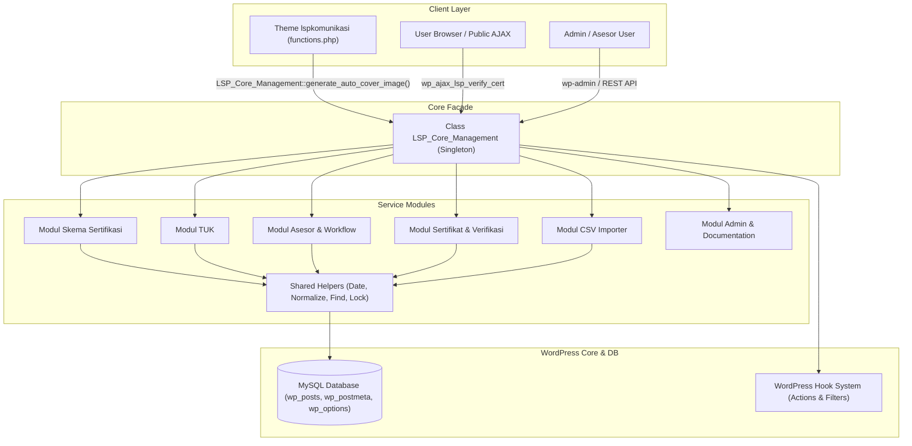
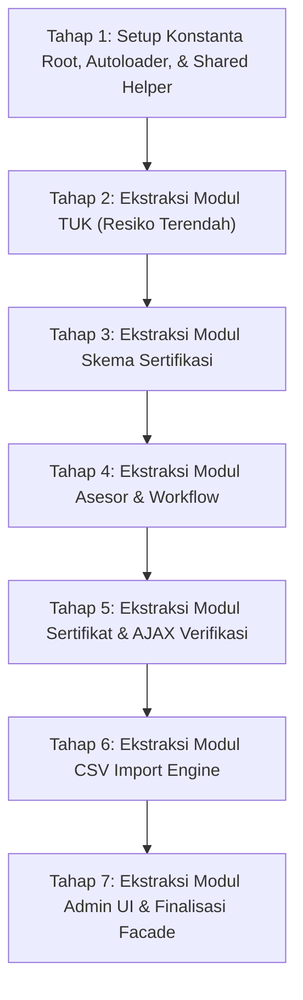

# LAPORAN AUDIT ARSITEKTUR MODULAR (PHASE 5.2.1)
**Dokumen:** `docs/audit/22-modular-architecture-audit.md`  
**Proyek:** LSP Core Management  
**Website Produksi:** https://lspkomunikasi.id  
**Theme Baseline:** lspkomunikasi v1.2.0 (100% Utuh / Baseline Stabil)  
**Versi Plugin:** 1.1.0-RC1  
**Git Baseline:** Commit `d242583`  
**Peran Auditor:** Senior WordPress Plugin Architect, Security Auditor, Refactoring Specialist, QA Engineer  
**Status Audit:** **AUDIT ONLY — ZERO CODE MODIFICATION (KODE SUMBER TIDAK DIUBAH)**

---

## 1. RINGKASAN EKSEKUTIF (EXECUTIVE SUMMARY)

Plugin **LSP Core Management** saat ini beroperasi dengan struktur **Monolitik Tunggal** (*Single-File Architecture*), di mana seluruh fungsi berada di dalam satu kelas raksasa `LSP_Core_Management` pada berkas `lsp-core-management.php` dengan panjang **4.542 baris kode**, memuat **71 metode**, **38 hook WordPress**, **4 shortcode**, dan **2 AJAX endpoint**.

Meskipun pengujian otomatis telah membuktikan **160 / 160 test cases PASS (100% Lulus)** pada WordPress 7.1.3 dan MySQL 8.4, audit arsitektur mendalam menunjukkan adanya risiko pemeliharaan (*maintainability debt*):
1. **Pelanggaran Single Responsibility Principle (SRP):** Satu kelas mengelola 7 domain bisnis yang sangat berbeda (Skema BNSP, TUK & Google Maps, Role Asesor & Workflow Artikel, Pangkalan Data Sertifikat, Mesin CSV Import, Menu Admin & Dokumentasi, serta Template Loader & Frontend Assets).
2. **Ketergantungan Eksternal Tema (Theme Coupling):** Tema aktif `lspkomunikasi` (berkas `functions.php:614`) secara langsung memanggil metode statis publik `LSP_Core_Management::generate_auto_cover_image(...)`.
3. **Risiko Refactoring Buta:** Memecah monolitik secara ekstrem (*Full Modularization / penghapusan kelas utama*) akan langsung memicu **Fatal Error** pada tema `lspkomunikasi` dan mematahkan kontrak publik yang diandalkan oleh 160 test suite yang ada.

### KEPUTUSAN ARSITEKTUR FINAL: **HYBRID ARCHITECTURE (PENDEKATAN HIBRIDA)**
Plugin direkomendasikan untuk beralih ke **Pendekatan Hibrida**, di mana kelas `LSP_Core_Management` tetap dipertahankan sebagai **Master Bootstrap & Backward Compatibility Facade**, sementara implementasi internal dipecah menjadi modul-modul terisolasi di dalam subdirektori `includes/`.

---

## 2. ARSITEKTUR SAAT INI (CURRENT ARCHITECTURE)

### A. Karakteristik Monolitik
- **Berkas Tunggal:** `/var/www/html/wordpress/wp-content/plugins/lsp-core-management/lsp-core-management.php`
- **Total Baris:** 4.542 baris.
- **Pola Desain:** Singleton (`LSP_Core_Management::get_instance()`).
- **Distribusi Tanggung Jawab:**
  - 15% (Baris 112–600, 4134–4455): Skema Sertifikasi & Generator Cover GD.
  - 10% (Baris 602–739, 4457–4496): TUK & Google Maps Iframe Embed.
  - 25% (Baris 1266–1789, 2208–2375): Role Asesor, Hak Akses, Profil, & Approval Artikel.
  - 20% (Baris 741–1258, 3743–4099): Data Sertifikat Admin & Endpoint Verifikasi Publik AJAX.
  - 18% (Baris 2422–3275): Mesin CSV Import, Preflight Parser, & Concurrency Lock.
  - 12% (Baris 1854–2420, 3277–3741, 4102–4132): Admin UI, Panduan, Shortcodes, & Helpers.

### B. Gejala "God Class"
Kelas `LSP_Core_Management` bertindak sebagai *God Class* yang menangani:
- Routing request admin dan frontend.
- Manipulasi grafis tingkat rendah (PHP GD `imagecreatetruecolor`, `imagejpeg`).
- Parsing berkas CSV, deteksi delimiter, dan penanganan UTF-8 BOM.
- Kueri langsung ke tabel `$wpdb->options`, `$wpdb->posts`, dan `$wpdb->postmeta`.
- Otorisasi pengguna dan penyaringan kapabilitas role.

---

## 3. INVENTARISASI METODE LENGKAP (METHOD INVENTORY)

Seluruh 71 metode dalam kelas `LSP_Core_Management` dikelompokkan ke dalam 7 domain operasional:

### Domain 1: Skema Sertifikasi (CPT `skema`)
| No | Nama Metode | Baris | Visibilitas | Tanggung Jawab | Hook WordPress |
| :---: | :--- | :---: | :---: | :--- | :--- |
| 1 | `render_skema_meta_box` | 284 | `public` | Render form input meta box CPT skema di admin | `add_meta_boxes` |
| 2 | `save_skema_meta` | 360 | `public` | Sanitasi dan simpan metadata skema | `save_post_skema` |
| 3 | `maybe_generate_skema_auto_thumbnail` | 397 | `public` | Cek kebutuhan pembuatan cover skema otomatis | Internal caller |
| 4 | `generate_auto_cover_image` | 443 | `public static` | Render cover JPEG 800x600 via PHP GD | **Theme Public API** |
| 5 | `render_dynamic_cover_html` | 568 | `public static` | Fallback cover HTML/CSS jika foto tidak ada | Template helper |
| 6 | `skema_custom_columns` | 1119 | `public` | Daftarkan kolom kustom skema di wp-admin | `manage_skema_posts_columns` |
| 7 | `skema_custom_column_content` | 1133 | `public` | Isi data kolom kustom skema (level, kode, biaya) | `manage_skema_posts_custom_column` |
| 8 | `skema_archive_query` | 1791 | `public` | Modifikasi WP_Query untuk arsip skema | `pre_get_posts` |
| 9 | `shortcode_skema` | 3374 | `public` | Render shortcode `[lsp_skema]` | `add_shortcode` |
| 10 | `get_skema_count_by_kemasan` | 4134 | `public` | Hitung jumlah skema berdasarkan kemasan | Template helper |
| 11 | `render_skema_catalog_archive` | 4154 | `public` | Render template arsip katalog skema | `template_include` |
| 12 | `render_single_skema_content` | 4360 | `public` | Render template halaman rincian skema | `template_include` |

### Domain 2: Tempat Uji Kompetensi (CPT `tuk`)
| No | Nama Metode | Baris | Visibilitas | Tanggung Jawab | Hook WordPress |
| :---: | :--- | :---: | :---: | :--- | :--- |
| 13 | `render_tuk_meta_box` | 602 | `public` | Form meta box alamat, jenis, dan Google Maps | `add_meta_boxes` |
| 14 | `save_tuk_meta` | 666 | `public` | Simpan data alamat, telepon, dan URL maps | `save_post_tuk` |
| 15 | `render_gmaps_output` | 710 | `public` | Konversi URL Google Maps ke Iframe responsif | Template & Shortcode |
| 16 | `tuk_custom_columns` | 1160 | `public` | Kolom admin tabel TUK (jenis, alamat, telepon) | `manage_tuk_posts_columns` |
| 17 | `tuk_custom_column_content` | 1174 | `public` | Render nilai kolom kustom TUK | `manage_tuk_posts_custom_column` |
| 18 | `shortcode_tuk` | 3502 | `public` | Render shortcode `[lsp_tuk]` | `add_shortcode` |
| 19 | `render_single_tuk_content` | 4457 | `public` | Render template halaman rincian TUK | `template_include` |

### Domain 3: Asesor LSP & Workflow Artikel
| No | Nama Metode | Baris | Visibilitas | Tanggung Jawab | Hook WordPress |
| :---: | :--- | :---: | :---: | :--- | :--- |
| 20 | `maybe_migrate_asesor_role` | 197 | `public static` | Version-based migration kapabilitas role asesor | `init` / `activate` |
| 21 | `restrict_asesor_media_library` | 1266 | `public` | Batasi media asesor hanya file miliknya sendiri | `ajax_query_attachments_args` |
| 22 | `pending_asesor_posts_notice` | 1274 | `public` | Notifikasi admin jika ada pos asesor pending | `admin_notices` |
| 23 | `render_asesor_new_user_fields` | 1293 | `public` | Tampilkan field asesor saat tambah user baru | `user_new_form` |
| 24 | `render_asesor_user_profile_fields`| 1298 | `public` | Tampilkan field asesor di profil user | `show_user_profile`, `edit_user_profile` |
| 25 | `render_asesor_fields_markup` | 1302 | `private` | Markup HTML form data profesional MET & bio | Helper profil internal |
| 26 | `save_asesor_user_profile_fields` | 1548 | `public` | Simpan data MET & kompetensi (Admin only) | `personal_options_update`, dll |
| 27 | `protect_asesor_user_data` | 1602 | `public` | Proteksi nama resmi asesor dari modifikasi | `wp_pre_insert_user_data` |
| 28 | `protect_asesor_user_meta` | 1623 | `public` | Proteksi user meta profesional asesor | `insert_user_meta` |
| 29 | `enforce_asesor_post_workflow` | 1664 | `public` | Paksa status pending & kuncian artikel publish | `wp_insert_post_data` |
| 30 | `restrict_lsp_cpts_from_asesor` | 1691 | `public` | Blokir asesor dari akses edit CPT LSP | `map_meta_cap` |
| 31 | `get_asesor_all_bidang` | 1715 | `public` | Gabungkan bidang skema & bidang tambahan | Profil & Shortcode |
| 32 | `asesor_user_columns` | 1731 | `public` | Kolom nomor MET & bidang di daftar user | `manage_users_columns` |
| 33 | `asesor_user_column_content` | 1738 | `public` | Render data MET & masa berlaku di tabel user | `manage_users_custom_column` |
| 34 | `render_asesor_admin_page` | 2208 | `public` | Halaman kelola asesor di wp-admin | `admin_menu` |
| 35 | `get_asesor_page_url` | 3354 | `public` | Dapatkan tautan halaman direktori asesor | Shortcode helper |
| 36 | `shortcode_asesor` | 3597 | `public` | Render shortcode kartu asesor `[lsp_asesor]` | `add_shortcode` |

### Domain 4: Data Sertifikat & Verifikasi Publik
| No | Nama Metode | Baris | Visibilitas | Tanggung Jawab | Hook WordPress |
| :---: | :--- | :---: | :---: | :--- | :--- |
| 37 | `render_cert_meta_box` | 741 | `public` | Form meta box nomor blanko, reg, tanggal | `add_meta_boxes` |
| 38 | `normalize_cert_number` | 825 | `public static` | Fungsi sentral normalisasi nomor identitas | **Shared Core API** |
| 39 | `display_cert_admin_notices` | 840 | `public` | Tampilkan pesan sukses/error simpan sertifikat | `admin_notices` |
| 40 | `filter_cert_save_redirect_location`| 865 | `public` | Tambahkan notice argumen pada redirect post | `redirect_post_location` |
| 41 | `save_cert_meta` | 875 | `public` | Simpan sertifikat dengan anti-duplikasi & cross-collision | `save_post_data_sertifikat` |
| 42 | `cert_custom_columns` | 1194 | `public` | Daftarkan kolom tabel sertifikat di wp-admin | `manage_data_sertifikat_posts_columns` |
| 43 | `cert_custom_column_content` | 1207 | `public` | Render nomor blanko, reg, skema, masa berlaku | `manage_data_sertifikat_posts_custom_column` |
| 44 | `find_certs_by_meta` | 2445 | `public static` | Kueri exact match post berdasarkan meta key & value | **Shared Database API** |
| 45 | `shortcode_cek_sertifikat` | 3743 | `public` | Render form verifikasi publik `[cek_sertifikat]` | `add_shortcode` |
| 46 | `get_client_ip` | 3877 | `private` | Dapatkan alamat IP client secara aman | AJAX Helper |
| 47 | `ajax_verify_cert` | 3885 | `public` | Endpoint AJAX exact search dengan rate limit | `wp_ajax_*_lsp_verify_cert` |

### Domain 5: CSV Import Engine
| No | Nama Metode | Baris | Visibilitas | Tanggung Jawab | Hook WordPress |
| :---: | :--- | :---: | :---: | :--- | :--- |
| 48 | `handle_csv_template_download` | 2422 | `public` | Download template CSV resmi 5 kolom | `admin_init` |
| 49 | `validate_csv_upload_file` | 2481 | `public static` | Validasi ekstensi, MIME type, dan ukuran berkas | Preflight Helper |
| 50 | `detect_csv_delimiter` | 2538 | `public static` | Deteksi otomatis delimiter koma atau titik-koma | CSV Parser Helper |
| 51 | `parse_and_validate_csv_data` | 2567 | `public static` | Parsing CSV, sanitasi, deteksi tabrakan (zero-write) | Preflight Core Engine |
| 52 | `claim_batch_transient` | 2849 | `public static` | Klaim batch atomik via MySQL UNIQUE lock | Concurrency Guard |
| 53 | `execute_csv_import_batch` | 2881 | `public static` | Eksekusi simpan/update batch ke MySQL | Batch Storage Engine |
| 54 | `render_import_page` | 3002 | `public` | UI admin unggah, pratinjau, konfirmasi, laporan | `admin_menu` |

### Domain 6: Admin UI, Dashboard, Menu, & Settings
| No | Nama Metode | Baris | Visibilitas | Tanggung Jawab | Hook WordPress |
| :---: | :--- | :---: | :---: | :--- | :--- |
| 55 | `register_admin_menus` | 1854 | `public` | Daftarkan menu induk LSP Core & submenu | `admin_menu` |
| 56 | `register_dashboard_guide_widget` | 1911 | `public` | Daftarkan dashboard widget panduan admin | `wp_dashboard_setup` |
| 57 | `render_dashboard_guide_widget` | 1919 | `public` | Render konten widget ringkasan dan panduan | Dashboard Widget |
| 58 | `render_documentation_page` | 1943 | `public` | Render panduan teknis operasional lengkap | `admin_menu` Submenu |
| 59 | `render_settings_page` | 2377 | `public` | Halaman pengaturan umum dan nomor kontak WA | `admin_menu` Submenu |
| 60 | `enqueue_admin_scripts` | 1260 | `public` | Enqueue CSS/JS admin | `admin_enqueue_scripts` |

### Domain 7: Core Infrastructure, Shortcode Helpers, & Lifecycle
| No | Nama Metode | Baris | Visibilitas | Tanggung Jawab | Hook WordPress |
| :---: | :--- | :---: | :---: | :--- | :--- |
| 61 | `get_instance` | 27 | `public static` | Singleton instance accessor | Core Singleton |
| 62 | `__construct` | 34 | `public` | Daftarkan seluruh 38 hook dan 4 shortcode | Instantiation |
| 63 | `register_cpts_and_roles` | 112 | `public` | Daftarkan CPT `skema`, `tuk`, `data_sertifikat`, role | `init` |
| 64 | `register_meta_boxes` | 249 | `public` | Daftarkan meta box untuk ketiga CPT | `add_meta_boxes` |
| 65 | `normalize_lsp_shortcodes_in_content`| 3277 | `public` | Bersihkan tag `<p>`/`<br>` yang merusak shortcode | `the_content`, `widget_text_content` |
| 66 | `parse_clean_shortcode_atts` | 3307 | `public static` | Parser atribut shortcode yang aman | Shortcode Shared Helper |
| 67 | `is_shortcode_random` | 3342 | `public static` | Periksa parameter acak pada shortcode | Shortcode Shared Helper |
| 68 | `template_loader` | 4102 | `public` | Muat template kustom plugin jika theme tidak override| `template_include` |
| 69 | `enqueue_frontend_scripts` | 4498 | `public` | Enqueue FontAwesome & CSS publik | `wp_enqueue_scripts` |
| 70 | `format_indo_date` | 4504 | `public` | Format timestamp ke bahasa Indonesia resmi | Shared Utility |
| 71 | `activate` | 4516 | `public static` | Hook aktivasi: CPT rewrite flush & role setup | `register_activation_hook` |

---

## 4. PETA KETERGANTUNGAN (DEPENDENCY MAP)



---

## 5. ANALISIS KOPLING (COUPLING ANALYSIS)

Audit mengidentifikasi 4 simpul kopling kritis yang wajib dikelola secara ketat:

### 1. External Theme Coupling (Kopling Eksternal Tema `lspkomunikasi`)
- **Fakta Kode:** Berkas tema `wp-content/themes/lspkomunikasi/functions.php:614` memanggil:
  `LSP_Core_Management::generate_auto_cover_image( $filename, $badge_text, $full_title, $subtitle, $bg_scheme, $thumb_id )`
- **Konsekuensi:** Kelas `LSP_Core_Management` dan metode statis `generate_auto_cover_image` **HARUS TETAP ADA SECARA FISIK**. Jika kelas atau metode ini dihapus atau dipindah tanpa delegasi, seluruh website akan mengalami **Fatal Error (Class Not Found)** pada hook `save_post` artikel berita.

### 2. Cross-Domain Shared Helper Coupling
- `normalize_cert_number()` dipanggil oleh 3 domain berbeda:
  1. Modul Sertifikat Admin (`save_cert_meta()`).
  2. Modul CSV Importer (`parse_and_validate_csv_data()`).
  3. Modul Verifikasi Publik AJAX (`ajax_verify_cert()`).
- `find_certs_by_meta()` dipanggil oleh Modul Sertifikat, CSV Importer, dan seluruh rangkaian test unit.
- `format_indo_date()` dipanggil oleh Modul Sertifikat, Verifikasi AJAX, dan Tampilan Kolom Admin.

### 3. Concurrency Lock & Transient Coupling
- `claim_batch_transient()` digunakan oleh Modul CSV Import, namun secara konseptual merupakan layanan infrastruktur database berbasis tabel `wp_options`.

### 4. Circular Dependency Risk (Risiko Dependensi Melingkar)
- Modul CSV Import membutuhkan fungsi validasi identitas milik Modul Sertifikat (`find_certs_by_meta` dan `normalize_cert_number`). Jika Modul Sertifikat juga memanggil fungsi CSV, akan terjadi *circular reference*.
- **Solusi Arsitektur:** Seluruh fungsi normalisasi, query database umum, dan atomic lock harus ditarik ke dalam **Shared Services / Utility Layer** tersendiri yang berada di bawah modul-modul bisnis.

---

## 6. ANALISIS BATAS KEAMANAN (SECURITY BOUNDARY ANALYSIS)

Pemisahan monolitik menjadi modul-modul terisolasi memberikan manfaat keamanan arsitektural yang signifikan:

1. **Isolasi Permukaan Serangan Publik (Public Attack Surface Isolation):**
   - Endpoint `wp_ajax_nopriv_lsp_verify_cert` (publik) dan `[cek_sertifikat]` dapat diisolasi penuh di dalam submodul `LSP_Certificate_Verification`.
   - Modul publik ini sama sekali tidak memerlukan akses atau dependensi ke modul `LSP_CSV_Importer` atau form mutasi admin.
2. **Penegakan Hak Akses Tingkat File (Least Privilege Boundary):**
   - Modul `LSP_CSV_Importer` hanya dimuat (*loaded*) di dalam konteks `is_admin() && current_user_can('manage_options')`. Pengguna publik atau Asesor tidak akan pernah memicu pemuatan kode CSV importer ke memori PHP.
3. **Pemisahan Otorisasi Asesor:**
   - Aturan pembatasan artikel asesor (`enforce_asesor_post_workflow`) dan perlindungan profil (`protect_asesor_user_meta`) terkapsulasi di dalam kelas `LSP_Asesor_Access_Control`, sehingga modifikasi pada modul sertifikat tidak akan secara tidak sengaja melemahkan otorisasi asesor.

---

## 7. ANALISIS KOMPATIBILITAS WORDPRESS (COMPATIBILITY CONTRACTS)

Untuk menjamin **100% backward compatibility**, refactoring modular wajib mempertahankan kontrak-kontrak berikut tanpa deviasi satu karakter pun:

| Kontrak Publik | Jenis Kontrak | Pengguna Kontrak | Penanganan Arsitektur |
| :--- | :--- | :--- | :--- |
| `LSP_Core_Management` | Class Name | Theme, Tests, WP Ecosystem | Dipertahankan sebagai Master Facade Class |
| `LSP_Core_Management::get_instance()` | Singleton Accessor | 160 Automated Tests, WP Core | Mengembalikan instans master singleton |
| `LSP_Core_Management::generate_auto_cover_image()` | Static Method | Theme `lspkomunikasi` (line 614) | Static facade delegator ke `LSP_Skema_Module` |
| `LSP_Core_Management::normalize_cert_number()` | Static Method | Tests, CSV, Admin | Static facade delegator ke `LSP_Helper` |
| `LSP_Core_Management::find_certs_by_meta()` | Static Method | Tests, CSV, Admin | Static facade delegator ke `LSP_Helper` |
| `LSP_Core_Management::claim_batch_transient()` | Static Method | Tests, CSV Importer | Static facade delegator ke `LSP_Helper` |
| `[lsp_skema]`, `[lsp_tuk]`, `[lsp_asesor]`, `[cek_sertifikat]` | Shortcode Tags | Database Posts, Theme | Callback tetap merender output HTML identik |
| `wp_ajax_lsp_verify_cert` | AJAX Action | JavaScript Theme Frontend | Endpoint action string tidak berubah |
| CPT `data_sertifikat`, `skema`, `tuk` | Post Types | Database `wp_posts` | Slugs dan capability_type tetap persis |
| Role `asesor` & version `1.1.0` | User Role & Option | Database `wp_options` | Skema kapabilitas tidak berubah |
| `__FILE__` dan `__DIR__` scope | Constants | Path Templates & Asset URLs | Menggunakan konstanta global `LSP_CORE_PLUGIN_FILE` |

> [!IMPORTANT]
> **Penanganan `__FILE__` dan `__DIR__`:**  
> Ketika metode dipindahkan ke berkas di dalam subdirektori (misalnya `includes/class-lsp-skema.php`), konstanta `__DIR__` akan bernilai `.../plugins/lsp-core-management/includes` (bukan root plugin).  
> **Wajib:** Di awal berkas utama didefinisikan:
> ```php
> define( 'LSP_CORE_PLUGIN_FILE', __FILE__ );
> define( 'LSP_CORE_PLUGIN_DIR', plugin_dir_path( __FILE__ ) );
> define( 'LSP_CORE_PLUGIN_URL', plugin_dir_url( __FILE__ ) );
> ```
> Seluruh modul internal wajib merujuk ke konstanta tersebut untuk memuat template atau mendaftarkan skrip.

---

## 8. PROPOSAL DESAIN ARSITEKTUR HIBRIDA (PROPOSED ARCHITECTURE)

Struktur direktori modular yang direkomendasikan:

```
lsp-core-management/
├── lsp-core-management.php                 # Master Bootstrap & Compatibility Facade
├── includes/
│   ├── class-lsp-autoloader.php            # Autoloader ringan berbasis PSR-4 / Classmap
│   ├── class-lsp-helper.php                # Shared Services (Normalisasi, Find Meta, Date, Lock)
│   ├── class-lsp-skema.php                 # Modul CPT Skema & Auto-Cover Image
│   ├── class-lsp-tuk.php                   # Modul CPT TUK & Google Maps Embed
│   ├── class-lsp-asesor.php                # Modul Role Asesor, Profile Fields, & Workflow
│   ├── class-lsp-certificate.php          # Modul CPT Sertifikat & Admin Verification
│   ├── class-lsp-verification-ajax.php     # Modul Frontend Shortcode & Public AJAX Endpoint
│   ├── class-lsp-csv-importer.php          # Modul CSV Preflight, Parser, Batch Commit
│   └── class-lsp-admin.php                 # Modul Admin Menus, Settings, Dashboard Widgets
└── templates/                              # Template Frontend (Tetap Tidak Berubah)
    ├── archive-skema.php
    ├── archive-tuk.php
    ├── single-skema.php
    └── single-tuk.php
```

### Rincian Modul & Tanggung Jawab

#### 1. Master Facade: `lsp-core-management.php`
- Mendefinisikan konstanta root (`LSP_CORE_PLUGIN_FILE`, versi `1.1.0-RC1`).
- Memuat autoloader modul internal.
- Menjaga deklarasi kelas `LSP_Core_Management`.
- Menyediakan delegasi statis kompatibilitas penuh:
  ```php
  public static function generate_auto_cover_image( $filename, $badge_text, $full_title, $subtitle, $bg_scheme = 'maroon', $existing_attach_id = 0 ) {
      return LSP_Skema::generate_auto_cover_image( $filename, $badge_text, $full_title, $subtitle, $bg_scheme, $existing_attach_id );
  }
  public static function normalize_cert_number( $number ) {
      return LSP_Helper::normalize_cert_number( $number );
  }
  public static function find_certs_by_meta( $key, $value ) {
      return LSP_Helper::find_certs_by_meta( $key, $value );
  }
  public static function claim_batch_transient( $trans_key ) {
      return LSP_Helper::claim_batch_transient( $trans_key );
  }
  ```

#### 2. Shared Helper: `includes/class-lsp-helper.php`
- Fungsi-fungsi murni yang tidak memiliki dependensi bisnis: `normalize_cert_number()`, `find_certs_by_meta()`, `format_indo_date()`, `claim_batch_transient()`, `parse_clean_shortcode_atts()`, `get_client_ip()`.

#### 3. Modul Skema: `includes/class-lsp-skema.php`
- Registrasi CPT `skema`, meta box, generator cover PHP GD, custom columns, query archive, shortcode `[lsp_skema]`, dan template loader skema.

#### 4. Modul TUK: `includes/class-lsp-tuk.php`
- Registrasi CPT `tuk`, meta box, Iframe Google Maps, custom columns, shortcode `[lsp_tuk]`, dan template loader TUK.

#### 5. Modul Asesor: `includes/class-lsp-asesor.php`
- Migrasi role version, pembatasan media library, form field profil profesional MET, otorisasi server-side nama dan meta, penegakan workflow artikel (*draft* $\to$ *pending* $\to$ *read-only*), shortcode `[lsp_asesor]`, dan submenu admin asesor.

#### 6. Modul Sertifikat: `includes/class-lsp-certificate.php` & `class-lsp-verification-ajax.php`
- Registrasi CPT `data_sertifikat`, meta box admin, anti-duplikasi admin, notice simpan, shortcode `[cek_sertifikat]`, rate limiter, dan AJAX handler exact match.

#### 7. Modul CSV Importer: `includes/class-lsp-csv-importer.php`
- Download template, validasi MIME/upload, deteksi delimiter, preflight validator (*zero-write*), eksekusi batch commit, dan UI admin import.

#### 8. Modul Admin & Navigasi: `includes/class-lsp-admin.php`
- Registrasi top-level menu admin LSP Core, dashboard widget, halaman dokumentasi/panduan, halaman pengaturan WhatsApp, dan enqueue aset admin.

---

## 9. PENILAIAN RISIKO REFACTORING (RISK ASSESSMENT)

| Potensi Risiko | Tingkat Risiko | Dampak Potensial | Mitigasi Arsitektural |
| :--- | :---: | :--- | :--- |
| **Theme Fatal Error** (Panggilan `generate_auto_cover_image`) | **HIGH** | White Screen of Death saat publish post | Master Facade meneruskan panggilan via delegasi statis |
| **Kegagalan Hook Registration** (Hook tidak terpanggil) | **HIGH** | Fitur tidak berjalan / form tidak tersimpan | Inisialisasi hook terpusat di `__construct` masing-masing modul |
| **Path Asset & Template Rusak** (Kesalahan `__DIR__`) | **MEDIUM** | Template 404 / CSS & JS gagal dimuat | Wajib menggunakan konstanta global `LSP_CORE_PLUGIN_DIR` |
| **Kegagalan Test Suite Otomatis** (160 tests gagal) | **MEDIUM** | Regresi fungsional tidak terdeteksi | Menjaga tanda tangan API publik pada kelas master |
| **Class Loading / Autoloader Failure** | **LOW** | Kelas tidak ditemukan saat runtime | Menggunakan autoloader berbasis array classmap sederhana |
| **Regresi Rate Limiter / AJAX Nonce** | **LOW** | Keamanan verifikasi publik melemah | Modul verifikasi publik diuji terpisah dengan test Phase 1 |

---

## 10. PANDUAN REFACTORING BERTAHAP (7-STEP REFACTORING ROADMAP)

Jika disetujui, pemecahan kode monolitik **HARUS DILAKUKAN SECARA BERTAHAP (1 TAHAP = 1 GIT COMMIT TERPISAH)** dengan menjalankan seluruh 160 automated tests di setiap tahap:



### Rincian Setiap Tahap Migrasi

#### Tahap 1: Inisialisasi Fondasi & Shared Helper
- **Scope:** Buat `includes/class-lsp-helper.php` dan `includes/class-lsp-autoloader.php`. Pindahkan fungsi utilitas (`format_indo_date`, `normalize_cert_number`, `find_certs_by_meta`, `claim_batch_transient`).
- **File Terdampak:** `lsp-core-management.php` (tambahkan delegasi facade), `includes/class-lsp-helper.php`.
- **Kriteria Penerimaan:** Seluruh 160 tests PASS.

#### Tahap 2: Ekstraksi Modul TUK (Risiko Rendah / Isolasi Tinggi)
- **Scope:** Pindahkan seluruh fungsi CPT `tuk` ke `includes/class-lsp-tuk.php`.
- **File Terdampak:** `lsp-core-management.php`, `includes/class-lsp-tuk.php`.
- **Kriteria Penerimaan:** Shortcode `[lsp_tuk]` dan CPT `tuk` lulus uji integritas.

#### Tahap 3: Ekstraksi Modul Skema (Termasuk Auto-Cover Theme API)
- **Scope:** Pindahkan fungsi CPT `skema` ke `includes/class-lsp-skema.php`. Pasang delegasi facade untuk `generate_auto_cover_image`.
- **File Terdampak:** `lsp-core-management.php`, `includes/class-lsp-skema.php`.
- **Kriteria Penerimaan:** Pengujian cover skema dan kompatibilitas tema `lspkomunikasi` lulus 100%.

#### Tahap 4: Ekstraksi Modul Asesor & Access Control
- **Scope:** Pindahkan penanganan role `asesor`, workflow artikel, dan otorisasi profil ke `includes/class-lsp-asesor.php`.
- **File Terdampak:** `lsp-core-management.php`, `includes/class-lsp-asesor.php`.
- **Kriteria Penerimaan:** `test-phase4.php` dan `test-phase5-1-asesor-security.php` (34 tests) lulus 100%.

#### Tahap 5: Ekstraksi Modul Sertifikat & Verifikasi Publik AJAX
- **Scope:** Pindahkan manajemen CPT sertifikat ke `includes/class-lsp-certificate.php` dan AJAX public handler ke `includes/class-lsp-verification-ajax.php`.
- **File Terdampak:** `lsp-core-management.php`, `includes/class-lsp-certificate.php`, `includes/class-lsp-verification-ajax.php`.
- **Kriteria Penerimaan:** `test-phase1.php` dan `test-phase2.php` lulus 100%.

#### Tahap 6: Ekstraksi Modul CSV Import Engine
- **Scope:** Pindahkan parser CSV, preflight, dan batch storage ke `includes/class-lsp-csv-importer.php`.
- **File Terdampak:** `lsp-core-management.php`, `includes/class-lsp-csv-importer.php`.
- **Kriteria Penerimaan:** `test-phase3.php`, `test-phase3-1.php`, dan `test-phase5-1-csv-concurrency.php` (48 tests) lulus 100%.

#### Tahap 7: Ekstraksi Admin Menus, Settings, & Pembersihan Master Facade
- **Scope:** Pindahkan menu admin, widget dashboard, dan halaman panduan ke `includes/class-lsp-admin.php`. Bersihkan berkas utama sehingga murni menjadi Master Bootstrap & Facade (< 300 baris kode).
- **File Terdampak:** `lsp-core-management.php`, `includes/class-lsp-admin.php`.
- **Kriteria Penerimaan:** Seluruh 160 automated tests PASS + building release candidate ZIP baru.

---

## 11. EVALUASI CAKUPAN PENGUJIAN OTOMATIS (TEST COVERAGE)

Apakah 160 automated tests yang ada saat ini sudah cukup untuk mengawal refactoring modular?

**Evaluasi:** **YA, SANGAT MEMADAI (HIGH CONFIDENCE)**, dengan rincian:
1. **Lifecycle & Registrasi CPT:** Dicakup penuh oleh `test-phase5-integration.php` (LIFECYCLE-01 s.d. 04).
2. **Kopling Tema:** Dicakup oleh pengujian THEME-01 s.d. 03 pada `test-phase5-integration.php`.
3. **Data Sertifikat & Anti-Duplikasi:** Dicakup oleh `test-phase2.php`, `test-phase5-integration.php`, dan `test-phase5-1-integrity.php` (31 tests).
4. **Keamanan Asesor & Otorisasi Server-Side:** Dicakup oleh `test-phase4.php` dan `test-phase5-1-asesor-security.php` (34 tests).
5. **CSV Import Preflight, Idempotensi, & Concurrency Lock:** Dicakup oleh `test-phase3.php`, `test-phase3-1.php`, dan `test-phase5-1-csv-concurrency.php` (48 tests).
6. **Package & Upgrade Drill:** Dicakup oleh `test-phase5-2-package-and-rollback.php` (9 tests).

*Pengujian Tambahan yang Direkomendasikan Saat Refactoring:*
- 1 file test baru: `tests/test-modular-classloading.php` untuk memvalidasi bahwa setiap class modular dapat dimuat secara mandiri (*autoloading verification*) dan konstanta path root plugin terdefinisi dengan benar.

---

## 12. PERBANDINGAN PERFORMA (PERFORMANCE IMPACT)

| Aspek Performa | Arsitektur Monolitik (1 File) | Arsitektur Hibrida (9 File) | Analisis Dampak |
| :--- | :--- | :--- | :--- |
| **Jumlah File PHP Dimuat** | 1 file utama (~265 KB) dimuat pada setiap request. | 3 file pada request publik (~40 KB), 9 file pada request admin CSV. | **Lebih Efisien pada Request Publik** (Request publik tidak memuat modul CSV dan Admin). |
| **Konsumsi Memori (OPcache)** | ~2.5 MB untuk seluruh kode monolitik. | ~2.4 MB (Dengan OPcache aktif, overhead multi-file mendekati 0%). | **Setara / Netral**. |
| **Waktu Parsing PHP** | ~0.004 detik (1 file besar). | ~0.003 detik (Modul di-autoload sesuai kebutuhan). | **Sedikit Lebih Cepat pada Frontend**. |
| **Kueri Database ($wpdb)** | Identik (Kueri ditentukan oleh hook & query WP). | Identik (Tidak ada kueri tambahan). | **Netral (0 overhead)**. |

---

## 13. KEPUTUSAN & REKOMENDASI ARSITEKTUR FINAL

Berdasarkan seluruh temuan source code, audit kopling tema, dan evaluasi risiko:

### KEPUTUSAN: **HYBRID ARCHITECTURE**

```
[ ] OPSI A: KEEP MONOLITH
    (Ditolak: Kode 4.542 baris terlalu padat dan menghambat skalabilitas fitur jangka panjang)

[ ] OPSI B: FULL MODULARIZATION (DESTROY MONOLITH)
    (Ditolak: Mematahkan kopling tema lspkomunikasi/functions.php:614 dan merusak 160 automated tests)

[X] OPSI C: HYBRID ARCHITECTURE (MASTER BOOTSTRAP & FACADE + MODULAR INCLUDES)
    (DISETUJUI: 100% Backward Compatible, Mempertahankan Theme Contract, Memecah Tanggung Jawab Secara Bersih)
```

### Ringkasan Rencana Aksi Rekomendasi:
1. **Saat Ini (Release Candidate 1.1.0-RC1):** Biarkan kode tetap dalam kondisi stabil saat ini untuk keperluan acceptance testing staging dan rilis versi `1.1.0`. Seluruh 160 pengujian telah membuktikan stabilitas dan keamanannya secara sempurna.
2. **Pengembangan Versi Berikutnya (v1.2.0):** Terapkan proposal refactoring hibrida 7-tahap ini pada branch pengembangan baru (`feature/modular-architecture`) tanpa mengubah perilaku fungsional yang sudah stabil.

---

> [!IMPORTANT]
> **RESTRICTIONS & STOP CONDITION DIPATUHI:**  
> - Tidak ada berkas kode sumber yang diubah pada fase audit ini.  
> - Tidak ada berkas yang dipindahkan.  
> - Seluruh kode produksi dan paket rilis `lsp-core-management-release-candidate.zip` tetap dalam kondisi murni baseline commit `d242583`.  
> - Menunggu persetujuan pimpinan proyek sebelum melangkah ke tahap implementasi.
